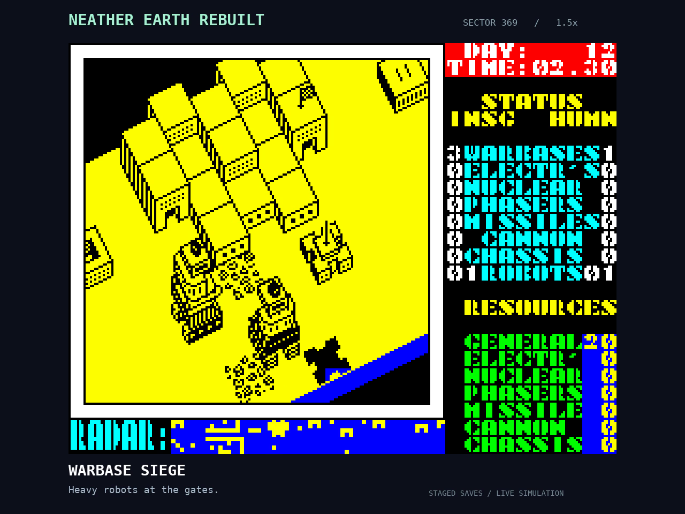
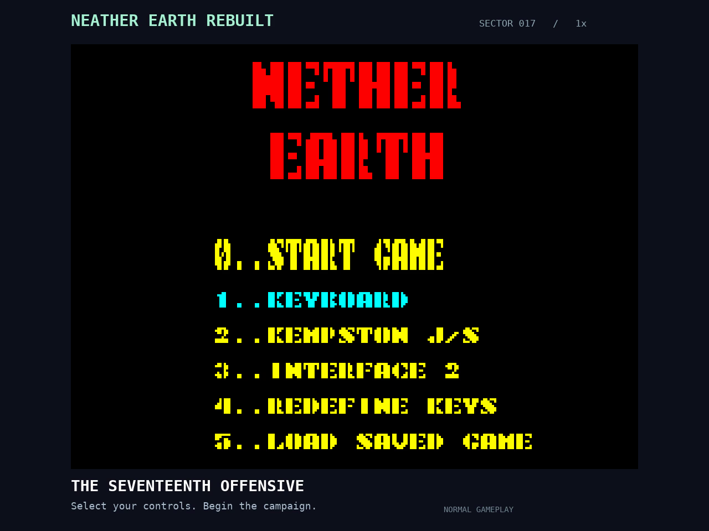
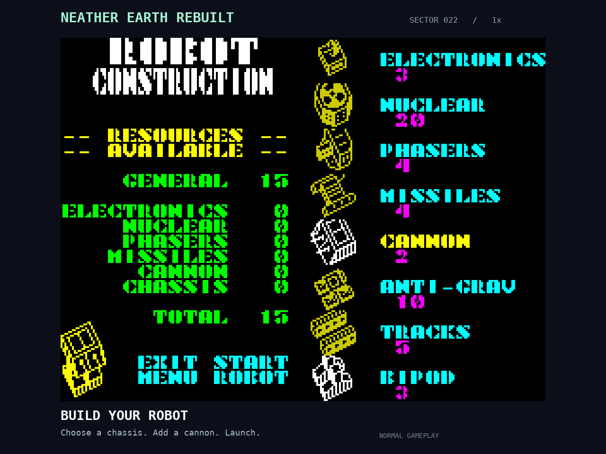
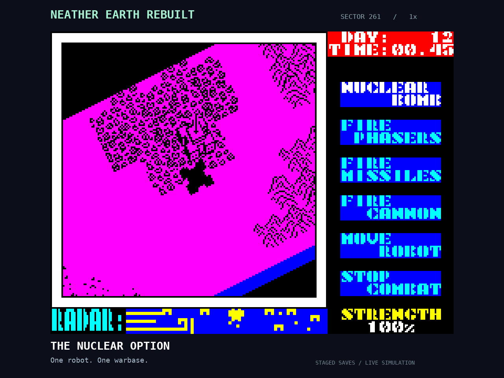

# Neather Earth Rebuilt

A playable TypeScript reconstruction of the original game, using its recovered map, graphics, font, UI scripts, and simulation rules. The browser executes native TypeScript game logic; the Z80 emulator is used only for differential tests and offline audio extraction.

The complete game is implemented and verified through a normal-start victory. See [fidelity evidence and browser timing boundaries](docs/fidelity.md).

**[Play in your browser](https://realill.github.io/neather-earth-rebuilt/)** · **[Watch the gameplay montage](https://realill.github.io/neather-earth-rebuilt/media/)**

## Gameplay video

[](https://realill.github.io/neather-earth-rebuilt/media/)

**Menu → build and launch a robot → battles across the map → nuclear blast.**

The opening uses normal controls. Battles use staged save files and the production game simulation, with synchronized effects and music. [Watch with playback controls](https://realill.github.io/neather-earth-rebuilt/media/) or [download the MP4](https://realill.github.io/neather-earth-rebuilt/media/gameplay.mp4).

## Screenshots

| Title menu | Build a robot |
| --- | --- |
|  |  |
| **Robot battle** | **Nuclear blast** |
|  |  |

## Sources and acknowledgments

- **[Nether Earth annotated disassembly](https://github.com/santiontanon/netherearth-disassembly), by Santiago Ontañón** — the primary reference for reconstructing mechanics, graphics tables, UI and sound. We used [revision 762e33e](https://github.com/santiontanon/netherearth-disassembly/tree/762e33e4bb1a5d2f608c6436d489a8376ef11cd5).
- **[World of Spectrum: Nether Earth](https://worldofspectrum.net/item/0003391/)** — original archive and [instructions](https://worldofspectrum.net/pub/sinclair/games-info/n/NetherEarth.txt), used to verify game data and controls.
- **[MDL Z80 assembler](https://github.com/santiontanon/mdlz80optimizer)** — assembled the reference privately for byte comparison and data-address extraction.
- **[JSSpeccy 3](https://github.com/gasman/jsspeccy3)** — source of the 48K ROM used privately to recover sound behavior.
- **[z80-emulator / TRS-80 TypeScript tools](https://github.com/lkesteloot/trs80)** — the development-only CPU oracle for differential checks and audio extraction.

See [detailed provenance and rights](docs/provenance.md) and [NOTICE](NOTICE). Original executables, tape images, ROMs and disassembly are excluded from this repository. Original graphics/music retain their rights; Apache 2.0 applies to the reconstruction code.

## Publish on GitHub Pages

The game is published from `realill/neather-earth-rebuilt` at:

**https://realill.github.io/neather-earth-rebuilt/**

1. Put this package's contents at the repository root on the `main` branch, including the hidden `.github` directory. Upload the extracted files, not the ZIP itself or its outer folder.
2. Open repository **Settings → Pages → Build and deployment**, and select **GitHub Actions** as the source.
3. Open **Actions → Deploy Neather Earth Rebuilt → Run workflow**. Subsequent pushes to `main` test, build and deploy automatically.
4. Open the deployment URL. Click or press a key to enable sound; use a keyboard or gamepad to play.

The workflow uses GitHub's built-in token; no personal token needs to be stored in the repository. It builds and publishes only `dist/`. Original reference files and test tools are not included in the live website. Asset URLs are relative, so the game also works at a custom domain or another repository name.

This follows [GitHub's Pages workflow documentation](https://docs.github.com/en/pages/getting-started-with-github-pages/using-custom-workflows-with-github-pages). Saves remain in each player's browser.

## Downloadable packages

Run `npm run package` to create:

- `release/neather-earth-rebuilt-github.zip`: source, tests, data-only assets, corrected music, screenshots, montage and the deployment workflow. Extract it and upload its contents to the repository.
- `release/neather-earth-rebuilt-site.zip`: the prebuilt playable website. Extract it into a static web host's public directory; no build tools are needed. For a separate GitHub Pages repository, these files can be published from `main` / root using the “Deploy from a branch” setting.
- `release/SHA256SUMS.txt`: archive checksums.

The source ZIP excludes `node_modules`, Git history and generated builds. Both packages retain the applicable attribution; see [source provenance](docs/provenance.md).

## Run

Use Node.js 22.12 or newer and npm.

```sh
npm ci
npm run dev -- --port 5174
```

Open http://localhost:5174. To build static files, run `npm run build`; the output is in `dist/`. Serve that directory over HTTP at the site root or under a repository path, or run `npm run preview -- --port 5178`.

## Play

Capture or destroy the three Insignian warbases while keeping your own base, Kerberus.

- **Flight:** Q/A/O/P or arrow keys move. Hold Space or right Shift to climb; release to descend.
- **Build:** land on the H at your warbase. Up/down select a part; fire adds or removes it. Left/right choose Exit, Start, or Parts. A robot needs one chassis and one to three weapons. Start launches it.
- **Command:** land on a friendly robot. Choose direct control, orders, combat, or leave. Orders include moving a distance, capturing factories/bases, and attacking targets.
- **Combat:** select a fitted weapon to fire it. Direct control changes the robot's direction; fire returns to the menu.
- **Pause:** 1 or Escape. **Abort to title:** I. **Save:** 5 or the Save button. On the title, 5 restores the browser save.
- **Title:** 0 starts; 1 selects keyboard; 2/3 enable a connected gamepad; 4 redefines all eight Spectrum actions. Interface 2 also accepts 6/7/8/9/0 as left/right/down/up/fire. Keyboard controls remain available with a joystick selected, as in the original.
- **Sound:** enabled by default and unlocked by your first click or keypress. Click the screen on the title to hear the music. The Sound button mutes/unmutes music and effects. Flight itself is quiet; menus and combat produce the original effects.

Key definitions are part of a saved game. Arrow keys remain available after redefining keys; Space is an extra fire key only when it is not assigned to another action. The surrounding buttons, browser save storage, arrows, Escape, and fullscreen are modern conveniences.

## Verification

```sh
npm test
npm run build
# With the local server running and Chrome installed:
npm run test:browser
npm run test:audio
npm run test:victory
```

The browser test defaults to `/usr/bin/google-chrome`. Override `CHROME_PATH` and/or `GAME_URL` as needed. It uses actual keyboard events to redefine controls, fly to Kerberus, build a robot, save/load, land on the robot, issue orders, take direct control, and fire a cannon. A second path earns income, builds a nuclear robot, and verifies detonation and pause/resume. It writes a screenshot to `/tmp/nether-browser-playthrough.png`. The separate audio check measures nonzero title and effects output under Chrome’s normal autoplay policy. The victory check replays 49,679 ordinary control inputs from a new game and verifies the ending delay, return to title, and restart; its screenshot is `/tmp/nether-victory.png`.

`npm test` verifies the full campaign with rendering enabled and the audio resampling. Original-code differential checks were also run privately during development. `npm run campaign` runs the acceptance player that generated the victory fixture. It only changes the game through normal controls and interrupts.

## License and assets

The reconstruction code is licensed under [Apache 2.0](LICENSE). The original graphics, music, map, font and interface data retain their original rights; see [NOTICE](NOTICE) and [provenance](docs/provenance.md).

The public package contains data-only asset segments and rendered audio. It excludes the original executable, tape images, Spectrum ROM, disassembly and reference-only extraction/tests. Building and playing require none of those files.

## Code

- `world.ts`: map initialization, building ownership, resources.
- `mechanics.ts`: movement, collision, radar, projectiles, damage, RNG.
- `game.ts`: robot orders, enemy production, construction, captures, clock, nuclear damage.
- `render.ts` / `screen.ts`: original masked sprites and Spectrum screen/UI rendering.
- `controller.ts` / `input.ts`: flight, menus, construction, Spectrum keyboard and browser gamepad input.
- `explosion.ts`: native instruction-boundary translation of nuclear color/noise effects and their interrupt/RNG interleaving.
- `audio.ts`: playback of original instruction-timed beeper transitions and extracted title music.
- `save.ts`: validated browser save records.

Original addresses are retained where useful for comparing states directly. Graphics and constants are read from data-only asset segments. The browser runs the TypeScript reconstruction.

## Scenario saves and battle montage

**Export save** downloads the current game as JSON. **Import save** restores a JSON save, including staged encounters. Invalid files leave the current game intact. The existing Save/Load buttons still use browser storage.

Run `npm run scenarios` to create five scenario saves under `captures/action-montage/saves/`. Import any encounter JSON (not `scenes.json`) to play it. Factory Crossfire, Ridge Ambush, Warbase Siege and Eastern Front start with opposing robots already deployed. Nuclear Finale starts in the nuclear robot's combat menu; press fire to detonate.

Run `npm run montage` to render the 53-second menu → construction → battle → nuclear montage with FFmpeg and DejaVu fonts installed. The scenario files set initial positions, equipment and resources. The production game simulation determines combat, damage, casualties and nuclear destruction. The first four encounters run at 1.5× playback speed; the nuclear sequence runs at normal speed. Captions identify staged footage. Actual sound events are synchronized over a quiet music track. The renderer writes `gameplay.mp4`, four screenshots, saves and a report to `captures/action-montage/`. Intermediate video/audio files are created in a temporary directory and automatically removed. Published media lives in `public/media/`. [Download the five scenario saves](https://realill.github.io/neather-earth-rebuilt/media/scenario-saves.zip) and use **Import save** in the game to play them.
